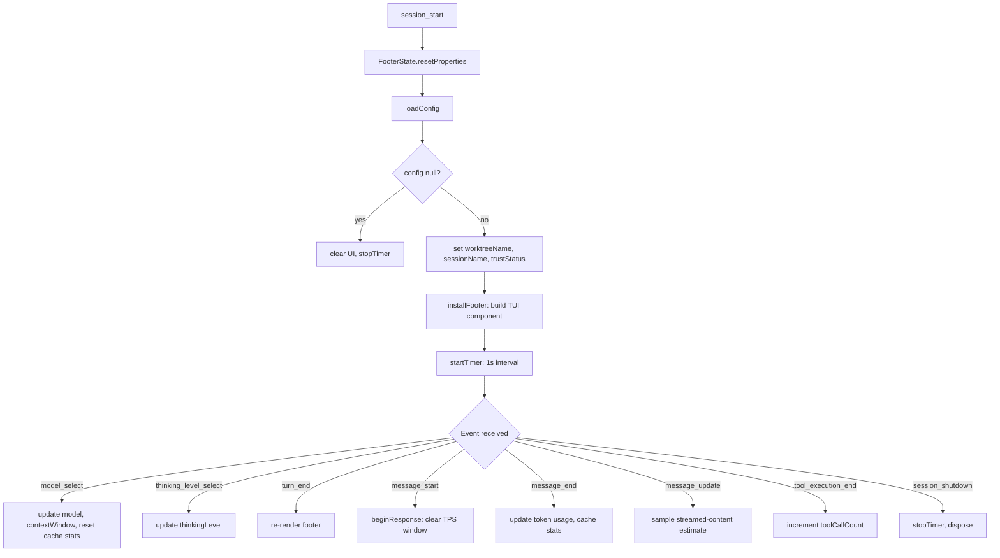

# Context Info

**Rich TUI status bar.** Replaces pi's default footer with real-time information — git branch, active model, token usage, TPS during streaming, cache hit rate, session name, trust status, and more.

## Why

pi's built-in footer is minimal. Context Info turns it into a mission-control dashboard:

- **Git branch** — current worktree name (critical when running multi-worktree pipelines)
- **Model** — active model name with context window
- **Token usage** — running token count with configurable thresholds (color-coded: green → yellow → red)
- **TPS** — tokens-per-second during streaming, estimated from the streamed content on `message_update` events and shown with a `~` estimate marker
- **Cache stats** — cache read/write counts plus an explicit `Cache Hit Rate` percentage
- **Session info** — session name (from `pi.getSessionName()`), session ID
- **Thinking level** — current thinking mode (low/medium/high)
- **Trust status** — project trusted/untrusted indicator
- **Live timer** — session duration counter
- **Tool call counter** — running count of tool executions this session
- **Appearance-aware text** — secondary text (labels, timer, cache stats) adapts to the terminal via the theme's reported `appearance`: `muted` on light backgrounds, `dim` on dark, falling back to `dim` when the theme reports none

Plus `/explain-extensions`, `/explain-prompts`, `/explain-skills` commands listing all active extensions, prompts, and skills with descriptions.

## How it works

1. **Session start** — `FooterState` is created, reads config from `.pi/settings.json` (in `contextInfo` section), detects git worktree name, captures session name and trust status
2. **Footer render** — Custom footer is installed via `ctx.ui.setFooter()`, replacing the default pi footer. Only active in TUI mode.
3. **Event hooks** — Updates footer reactively on:
   - `model_select` — new model, context window
   - `thinking_level_select` — thinking mode change
   - `turn_end` — refresh all counters
   - `message_start` — reset the streaming window for a new assistant message
   - `message_end` — capture token usage + cache stats from raw event
   - `message_update` — sample the streamed content for the TPS estimate
   - `tool_execution_end` — increment tool call counter
4. **Timer** — Interval-based timer updates the session duration display every second
5. **Session end** — Timer stops, footer disposed

### Status widgets

| Widget                   | Shows                             | Updates                                    |
| ------------------------ | --------------------------------- | ------------------------------------------ |
| `contextUsage`           | Token usage with color thresholds | On every message_end                       |
| `contextCache`           | Cache read/write + `Cache Hit Rate` | On message_end (when cache data available) |
| `contextFooter`          | Full footer bar                   | On any relevant event                      |
| Themed working indicator | Animated dot pulse                | During agent execution                     |

### Configuration (optional)

In `.pi/settings.json`:

```json
{
	"contextInfo": {
		"showTimer": true,
		"showWorktree": true,
		"showToolCount": true,
		"thresholds": {
			"tokenGreen": 10000,
			"tokenYellow": 30000,
			"tokenRed": 60000
		}
	}
}
```

## Install

Part of Cheasee-Pi monorepo. Activated automatically.

## Requirements

- Pi Coding Agent ≥ 0.79.1 (for `isProjectTrusted`, `mode` in context)
- Works with any TUI theme (uses theme colors from ctx.ui.theme)

## Details

### Architecture

Reactive footer system with event-driven updates:

```
├── index.ts            # Entry: event hooks, state management, /explain-* commands
│                       #   inlined: getWorktreeName, tryEmit, CASTLE_ART / cheasee-pi-info
├── footer.ts           # installFooter: builds TUI footer component tree
├── footer-state.ts     # FooterState: mutable state container with render triggers
├── cache-stats.ts      # computeCacheHitRate: pure cache hit-rate policy
├── stream-estimate.ts  # estimateStreamedTokens: pure streaming-token estimate
├── config.ts           # Load config from .pi/settings.json
├── types.ts            # ThresholdEntry, TpsSample, FooterConfig interfaces
├── markdown-resources.ts # Walker+extract: listMarkdownResources, inlined extractDescription
├── extensions.ts       # List active extensions
├── prompts.ts          # List available prompt templates
├── skills.ts           # List available skills
├── explain.ts          # createExplainCommand factory
└── test/               # Unit tests
```

### Footer State Machine



### Footer Component Tree

```
[Git branch] [Model] [Thinking] [timer] [Tokens used/max] [TPS] [Cache hit rate] [Session] [Trust] [Tool calls]
```

Each segment is a reactive Widget that updates when its backing `Reactive` value changes.

### Key Design Decisions

- **FooterState lifecycle** — Created on `session_start`, disposed on `session_shutdown`. Previous disposed before new to prevent stale `ctx` closures.
- **Working indicator** — Custom dot pulse (`·` `•` `●` `•`) instead of standard spinner.
- **TPS sampling** — On `message_update`, `estimateStreamedTokens` counts the characters of the streamed text, thinking and tool-call arguments, divides by 4 and rounds up. The count is monotonic within a response, so the rolling 30s estimator always has a positive delta. It deliberately ignores provider `usage.output`: providers that only populate output usage at completion left the sampler stuck at 0 and the footer showed `-- t/s` for the whole stream. Because the number is derived from content rather than from a tokenizer, the footer renders it as `~42.5 t/s` — the `~` is the estimate marker. `message_start` for an assistant message calls `FooterState.beginResponse()`, the single response-scoped reset; there is no decrease-based reset.
- **Cache hit rate** — `cacheRead / (input + cacheRead + cacheWrite) * 100` from one `message_end` usage record, written atomically with the counts (a record that cannot produce a rate mutates nothing). `input` is in the denominator so a provider reporting zero `cacheWrite` cannot saturate the metric at 100%: 100% is only reachable when `input` is 0, i.e. a fully cached prompt. The displayed percentage is therefore the cache-read share of *reported* prompt tokens, not a guarantee that every cache-eligible token was a hit — which is why the counts stay visible next to it. When the denominator is zero the footer shows `Cache Hit Rate: --`. `model_select` clears the counts and the rate together.
- **Not session totals** — both metrics describe the last assistant message. Aggregating across a session needs reset semantics for compaction and model switches, which is out of scope here.
- **Quiet startup** — `quietStartup: true` suppresses startup hint and working indicator.
- **Explain commands** — Widgets auto-cleared on first `input`/`before_agent_start`/`user_bash` event.
- **Supervisor integration** — Subscribes to the shared `supervisor:issue-data` bus event (topic and payload type in `lib/issue-data-event.ts`) to display the current issue number/title/repo in the TUI footer. Single write path — no exported setters.
- **Timer** — `setInterval` at 1s, cleared on shutdown.

### Event to Footer Update Map

| Event                   | Fields Updated                                    |
| ----------------------- | ------------------------------------------------- |
| `session_start`         | worktreeName, sessionName, trustStatus, sessionId |
| `model_select`          | modelName, contextWindow, cacheRead/Write + rate  |
| `thinking_level_select` | thinkingLevel                                     |
| `turn_end`              | sessionName                                       |
| `message_start`         | resets TPS samples + lastComputedTps              |
| `message_end`           | tokensUsed, tokensMax, cacheRead/Write, hitRate   |
| `message_update`        | TPS samples (streamed-content estimate)           |
| `tool_execution_end`    | toolCallCount                                     |
| `supervisor:issue-data` | issueNumber, issueRepo, issueTitle (bus event)    |

## License

MIT
